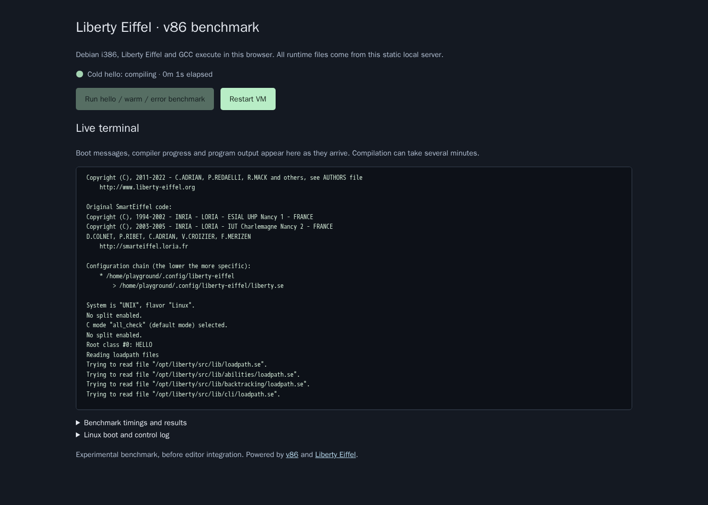

# Liberty Eiffel v86 Playground

A browser-only Liberty Eiffel experiment using **self-hosted, open-source v86**. Linux, the Eiffel compiler, GCC and the resulting executable all run inside the visitor's browser. The server serves static files only.

The current UI is a benchmark with live terminal output: hello, a warm repeat, and an intentional compiler error. It has no editor or interactive stdin yet. Compilation works, but takes about four minutes on the tested machine. This repository explores the v86 approach; an Emscripten implementation would be a separate experiment.



## Build and run

Requirements: Git, Docker with Linux containers, and Docker Compose. No host compiler, Node or Python is needed. The browser runtime requires no account or license key. Docker must support `linux/386`; ARM hosts need suitable emulation and are untested.

```sh
git clone https://github.com/andreamancuso/liberty-eiffel-v86-playground.git
cd liberty-eiffel-v86-playground
docker build --platform linux/386 -f docker/toolchain.Dockerfile --target runtime -t liberty-eiffel-v86:toolchain .
docker build --platform linux/386 -f docker/Dockerfile --target artifacts --output type=local,dest=artifacts .
docker compose up -d web
```

The initial compiler bootstrap takes roughly 30 minutes and may be quiet while building. Subsequent builds use Docker's cache. Allow several GB of free disk space for build images and the filesystem. Generated artifacts are deliberately excluded from Git: a fresh clone must run both build commands before starting the server. Building needs Internet access; running the built page does not.

Open **http://localhost:8082**, wait for Linux, then click **Run hello / warm / error benchmark**. Allow roughly ten minutes for the complete benchmark. Boot messages, verbose compiler progress, program output and errors stream into the terminal. Elapsed time remains visible during quiet stretches. Scroll up to pause automatic scrolling; return to the bottom to follow new output. The display retains the most recent 100,000 characters.

**Restart VM** discards guest changes. Stop the local server with `docker compose down`. Set `PLAYGROUND_PORT` in your shell or a local `.env` file to use another port, for example `PLAYGROUND_PORT=8083`.

## Verify in Docker

With the static server running:

```sh
docker compose --profile test build test
docker compose --profile test run --rm test
```

Playwright runs real Chromium inside Docker. It checks visible boot output, compiler output arriving before compilation finishes, the elapsed counter, two successful executions, an intentional compiler error with no execution, and exclusively local static GET requests. Reports and screenshots go into the ignored `test-results/` directory. The Docker toolchain build separately checks ELF32 architecture and native hello/error behavior.

## How it works

```text
Docker build: Liberty C bootstrap → native i386 compiler + GCC
              + Linux kernel/initramfs → v86 9p filesystem

Browser:     v86 JS/WASM → emulated x86 PC → Linux → Liberty → GCC → program
             source via create_file; live output via an emulated serial port

Static HTTP: HTML/JS, runtime, firmware, kernel and filesystem files
```

The guest has 1 GiB RAM and a 256 MiB tmpfs for compiler scratch files. Compilation runs as an unprivileged guest user. Compiler/program output travels over `ttyS1`; control messages remain on `ttyS0`, so printed output does not act as completion markers. Exit codes survive the logging pipeline. Completed logs are also read through v86's filesystem API. There is no compiler endpoint or external guest network relay.

The toolchain is installed ahead of time. Compilation uses `-verbose -no_split -all_check`, with generated C at `-O0`. The compiler itself uses Liberty's optimized bootstrap settings. Compiler and program timeouts are 600 and 10 seconds respectively, with a 660-second browser job deadline.

## Recorded results and limits

Verified on 2026-11-10 using Chromium 141.0.7390.37 / Playwright 1.56.1 in Docker Desktop Linux on Windows, on an AMD Ryzen 7 5700U. These are individual local observations with verbose streaming enabled. The compact [benchmark record](docs/benchmark.json) and screenshot come from the working prototype before repository layout cleanup; the application and guest execution code are unchanged.

| Check | Result |
| --- | --- |
| Linux startup | 44.081 s |
| Cold hello compilation | 251.826 s; exit 0 |
| Warm hello compilation | 241.188 s; exit 0 |
| Intentional compiler error | 80.004 s; exit 1, no execution |
| Native Docker hello compilation | About 3 s |
| Guest RAM | 1 GiB, plus browser/JIT/filesystem overhead |
| Browser download payload | About 106 MiB |
| Filesystem store | About 524 MiB, fetched on demand |

This proves the browser execution path, not interactive compilation speed or broad Eiffel compatibility. Caching alone did not remove the warm compilation delay. Only the recorded desktop Chromium version is verified; Firefox, Safari, mobile and low-memory devices are untested. v86 emulates 32-bit x86, without x86-64 or multiple guest cores. A native amd64 Docker image cannot be used unchanged.

Local hosting uses loopback HTTP with COOP/COEP headers. Production hosting would need suitable HTTPS/static hosting and separate validation. No public deployment is provided. Programs can consume tab CPU and memory; reload to discard the VM.

## Build provenance

| Component | Pin |
| --- | --- |
| Liberty Eiffel | `21b081378ec12798080128e7f39878d5d2097cb7` |
| v86 npm runtime | `0.5.473` |
| v86 firmware/packaging source | `315b2b0b758703ef0e6cc7b4088d6068f83f3c20` |
| Debian Bookworm base | Digest pinned in the Dockerfiles |
| Browser runner | Playwright `1.56.1` |

Generated npm integrity metadata, Debian package versions and filesystem checksums are saved under `artifacts/`. Debian repositories remain live, so this is a repeatable build procedure, not a bit-identical archive. The recorded image used kernel `6.1.0-54-686`. No local clone of an upstream dependency is required.

## License

[MIT](LICENSE) covers this project's original code and documentation. Third-party software retains its own licenses; see [THIRD_PARTY_NOTICES.md](THIRD_PARTY_NOTICES.md). This repository contains source and build recipes, not prebuilt emulator/toolchain/filesystem distributions. Publishing generated images requires the applicable third-party notices and corresponding-source material.
